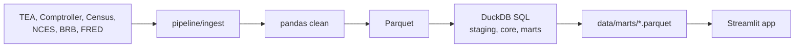

# Lone Star Ledger

**Texas School Finance Atlas.** How does per-student spending track district property wealth in
Texas, and which districts are the outliers?

> **Status: in development.** The app shell, theme and guarded SQL Lab are built. The data
> pipeline is waiting on the official source files (see
> [`data/raw/MANUAL_DOWNLOADS.md`](data/raw/MANUAL_DOWNLOADS.md)). No findings are published until
> they have been computed from the data.

## What it will cover
Nine pages: an interactive Atlas map, Wealth & Spending (the core question), Recapture, Bonds &
Debt, Growth & Construction, Equity Over Time, District Profiles, a read-only SQL Lab, and
Methodology & Data.

## How it works


## Run locally
```bash
pip install -r requirements-dev.txt
make data
streamlit run app.py
```

## Stack
Python, pandas, DuckDB, SQL, Streamlit, pydeck, Plotly. Built with Claude Code.
Fonts: Fraunces, Inter Tight, JetBrains Mono (SIL OFL).

## License
MIT
