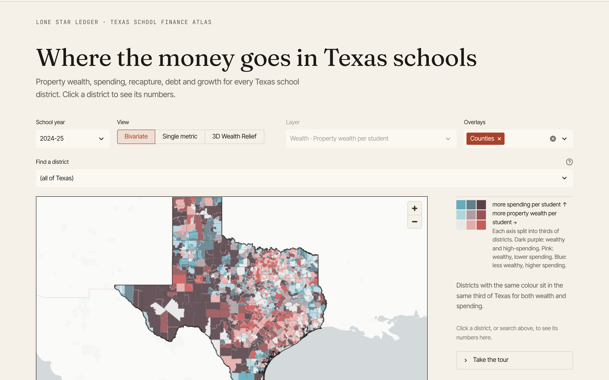
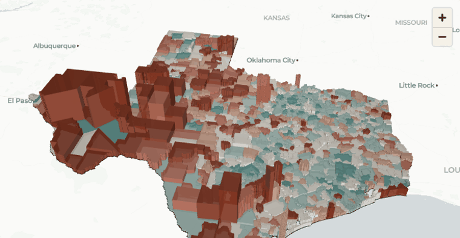
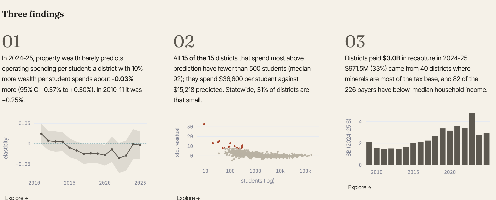
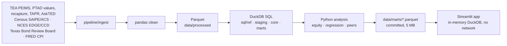

# Lone Star Ledger

**Texas School Finance Atlas.** How does per-student spending track district property wealth in Texas, and which
districts are the outliers? An interactive atlas of every Texas school district's wealth, spending, recapture, debt and
growth, built on a reproducible pipeline over official Texas and federal data.

**Live app:** https://texas-school-finance.streamlit.app





## Three findings

Computed from the committed marts by `scripts/readme_findings.py`. Each comes with the SQL that produced it.



<!-- findings:start -->
### 1. Property wealth barely predicts operating spending

In 2024-25, a district with 10% more property wealth per student spent about **-0.03%**
more per student (95% CI -0.37% to +0.30%; n = 1,008
districts, enrollment-weighted). In 2010-11 the figure was +0.25%. The spending gap
between the wealthiest and poorest fifths of students went from +6.1% to
+0.4%. After controlling for size, student need, locale and density, the elasticity is a
small positive +0.067 (95% CI +0.043 to +0.092).

```sql
-- Atlas findings strip: statewide equity in the first and latest years with property-wealth data.
SELECT year, elasticity, elasticity_lo, elasticity_hi, wealth_spend_corr, mean_spend, median_spend,
       quintile_gap_ratio, quintile_gap_dollars, mcloone, restricted_range_ratio, n_districts, students
FROM mart_equity_state_year
WHERE elasticity IS NOT NULL
ORDER BY year;
```

### 2. The biggest over-spenders are tiny rural districts

All **15 of the 15** districts that spend furthest above the controlled model's prediction
in 2024-25 have fewer than 500 students (median 92) and are rural. They spend a
median $36,600 per student against $15,218 predicted. Statewide,
31% of districts are that small. Size, more than wealth, marks the extremes.

```sql
-- Finding 02: who spends far more than the controlled model predicts (latest year)
SELECT direction, count(*) AS n,
       count(*) FILTER (WHERE small_district) AS n_small,
       count(*) FILTER (WHERE locale = 'Rural') AS n_rural,
       median(enrollment) AS median_enrollment,
       median(op_per_student_real) AS median_actual,
       median(predicted_real) AS median_predicted,
       (SELECT avg(small_district::INT) FROM mart_outliers_latest) AS share_small_statewide,
       any_value(year) AS year
FROM mart_outliers_latest
WHERE direction IS NOT NULL
GROUP BY direction;
```

### 3. A third of recapture comes from mineral wealth

Districts paid **$2.96B** in recapture in 2024-25. Of that, $971M
(33%) came from the 40 paying districts
where oil, gas and other minerals are most of the tax base, and 82 of the
226 payers have below-median household income. Property-rich is not the same as rich residents.

```sql
-- Finding 03: recapture by property mix and household income (2025; property mix of tax year 2025 - 1)
WITH y AS (
  SELECT m.cdn, m.recapture_paid, d.median_household_income AS income, p.mineral_share
  FROM mart_district_year m
  JOIN mart_districts d USING (cdn)
  LEFT JOIN mart_property_mix p ON p.cdn = m.cdn AND p.tax_year = 2025 - 1
  WHERE m.year = 2025 AND m.is_current
)
SELECT count(*) FILTER (WHERE recapture_paid > 0)                                   AS payers,
       sum(recapture_paid)                                                          AS total_paid,
       sum(recapture_paid) FILTER (WHERE mineral_share > 0.5)                       AS paid_by_mineral_majority,
       count(*) FILTER (WHERE recapture_paid > 0 AND mineral_share > 0.5)           AS payers_mineral_majority,
       count(*) FILTER (WHERE recapture_paid > 0 AND income < (SELECT median(income) FROM y)) AS payers_below_median_income
FROM y;
```

<!-- findings:end -->

## What's inside

Nine pages: **Atlas** (bivariate map, 13 single-metric layers, 3D Wealth Relief, overlays, guided tour) ·
**Wealth & Spending** (elasticity, controlled model, outliers, two kinds of wealth) · **Recapture** (flow map, money-cycle
Sankey) · **Bonds & Debt** (debt skyline, maturity profile, CAB exposure, tax anatomy) · **Growth & Construction** (new
campuses, capital intensity, labelled cost proxies) · **Equity Over Time** (2008-09 to 2024-25, ridgeline, rank slopes) ·
**District Profile** (`?district=<CDN>`) · **SQL Lab** (read-only DuckDB over the marts) · **Methodology & Data**.
Every chart has a "View SQL" expander showing the exact query.

## How it works



## Data and definitions (short)

- **Operating spending** = PEIMS objects 6100-6400 in operating functions, all funds, excluding capital projects funds.
  This reproduces TEA's published operating totals to 0.000% statewide (`data/qa/reconciliation.md`) and matches TEA's
  per-student figures for 5 spot-checked districts (`data/qa/spot_checks.md`). The headline also removes shared services
  arrangement fiscal-agent funds. **Excluded:** debt service (function 71 / object 6500), facilities and capital (function
  81 / object 6600), **recapture (function 91)** and intergovernmental charges (93, 97, 99). Codes cite TEA's FASRG
  Update 20.
- **Property wealth** = Comptroller-certified value "used for school funding" per student, tax years 2010-2025.
- **Universe:** ISDs and common districts with boundaries (1,017). Charters are reported separately. 9 districts with
  large virtual or non-resident enrollment are excluded from the model and equity metrics.
- **Real dollars:** CPI-U, July-June school-year average, 2024-25 dollars.
- Crosswalk TEA CDN ↔ NCES LEAID ↔ Census GEOID matches 99.8% of reporting ISDs (`data/qa/unmatched.csv`).

Sources and vintages: see the Methodology page or `config/sources.yaml`.

## Limitations

- **Bond elections are not included yet.** The Bond Review Board's election search (debtsearch.brb.texas.gov) was not
  reachable from the build environment; the open-data copy is a link last updated in 2017.
- ADA/WADA are not available in bulk (TEA's Summary of Finances has no statewide download), so per-student figures use
  fall enrollment. No cost adjustment is applied.
- The debt "maturity" view groups remaining debt service by final maturity year; BRB does not publish annual schedules
  in bulk. Construction costs are shown only as labelled proxies.
- All relationships are descriptive, not causal.

## Run locally

```bash
pip install -r requirements-dev.txt
make data            # download, build the DuckDB warehouse and marts, run data-quality checks
streamlit run app.py
```

The app itself needs only `requirements.txt` and the committed marts. `make data` needs internet access; put an
optional `FRED_API_KEY` in `.env` (a CPI snapshot is committed as a fallback).

## Deploy

Streamlit Community Cloud, from `main`, entry point `app.py`. No secrets are needed at runtime. Free apps sleep when
idle; cold start reads ~5 MB of Parquet.

## Stack

Python · pandas · DuckDB · SQL · statsmodels · scikit-learn · geopandas/topojson · Streamlit · pydeck · Plotly ·
Fraunces, Inter Tight, JetBrains Mono (SIL OFL). Built with Claude Code.

Author: [keithloboprabhu-cmd](https://github.com/keithloboprabhu-cmd). MIT License.
